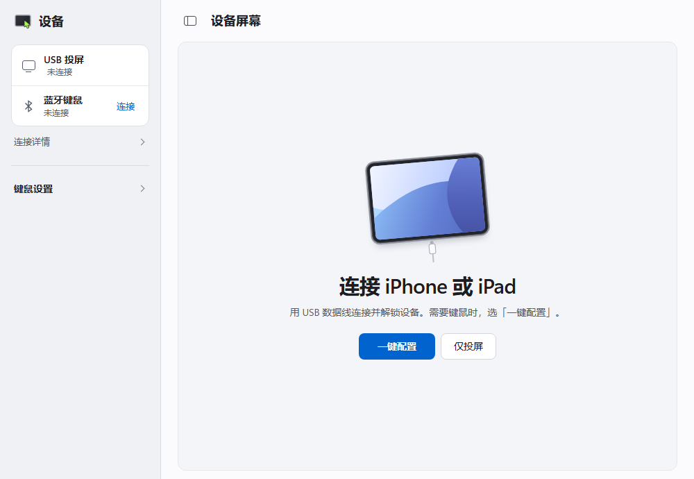

# iPad Control Console

**让电脑上的 AI 助手看见并操作你的 iPad 和 iPhone。**

以前，让 AI 帮忙找一个设置，往往要先截屏发给它，照着回答点几下，再截一张问「接下来呢？」。iPad Control Console 把设备的实时画面带到 Windows，也把鼠标和键盘操作送回设备。支持操作电脑窗口或运行本机命令的 AI 助手，可以自己看屏、点按、打字，再看一眼结果。手机和平板上无需安装 App。

**[下载 1.6.0 稳定版 · Windows x64 安装包](https://github.com/LiuJH12138/ipad-bluetooth-mouse/releases/download/v1.6.0/iPad-Control-Console-1.6.0-win-x64.msi)**　·　[发布说明与 SHA-256 校验](https://github.com/LiuJH12138/ipad-bluetooth-mouse/releases/tag/v1.6.0)　·　[使用手册](docs/guide.md)

## 第一次让 AI 操作设备

把 iPad 停在「设置」首页，连接控制台后，可以给能操作这台电脑的 AI 助手一个小任务。

> 帮我点开设置里的搜索框，输入 7319。看一眼 iPad 屏幕，告诉我框里实际显示了什么，然后清空它。

助手可以从投屏里找到搜索框，点击后确认光标已经出现，再输入数字、读回文字。你能在控制台看到每一步。已有的 AI 助手负责理解任务，控制台负责提供画面和键鼠输入。

| 你的 AI 助手能做什么 | 怎样接入 |
| --- | --- |
| 看见并操作 Windows 窗口 | 在控制台选择 **画面操控**，把窗口交给助手。它可以直接点投屏、在当前输入框打字。「允许助手控制」可保持关闭。 |
| 在这台电脑上运行命令 | 保持投屏，退出手动操控，再打开 **允许助手控制**。助手通过安装包内的 `assistant.js` 读图、点击和输入。用完点 **停止助手控制**。 |

[窗口操作示例](docs/guide.md#ai-如何操作-ipad) · [本机命令示例](docs/guide.md#本机助手控制)

## 界面展示

**连接设备。** 首页分别显示 USB 投屏和蓝牙键鼠的状态。选择「一键配置」可以一起准备两者，选择「仅投屏」可以直接看屏。

**确认控制目标。** 同时接上 iPad 和 iPhone 时，窗口标题显示当前设备的名称和八位短码。配对向导还会显示电脑的蓝牙名称，方便在正确的手机或平板上完成配对。

## 安装与连接

准备一台 **Windows 11 x64** 电脑、一根支持数据传输的 USB 线，以及已解锁的 iPad 或 iPhone。发送键鼠输入需要电脑的蓝牙适配器支持 **BLE 外设角色**，也就是能把电脑当作蓝牙键鼠来连接。

1. **安装控制台。** 下载页面顶部的 MSI，双击安装。已有版本可先在系统托盘退出控制台，再运行安装包升级。
2. **接入设备。** 用 USB 数据线连接设备，按提示在设备上确认信任电脑。在控制台点 **一键配置**，如果接了多台，就选择本次要使用的那台。
3. **核对键鼠。** 按向导在设备上开启辅助触控、配对电脑蓝牙，并停在清晰的静止页面。控制台移动指针，在当前投屏里确认三个落点，再开放相应的操控方式。

[首次配置与驱动](docs/guide.md#首次配置) · [连接故障排查](docs/guide.md#边界与常见问题)

## 控制权与隐私

- **同时连多台，一次操作一台。** 设备名称相似时，可在「连接详情」设置本机别名。切换设备会释放按住的键和鼠标按钮，并结束上一台设备的脚本授权。
- **画面停住，输入也会暂停。** 超过 4 秒没有新的 USB 解码帧时，助手读图和普通输入会暂停。再次操作时，控制台先移动指针检查新画面，核对失败就取消这次操作。
- **画面在本机解码。** 脚本读图需要单独授权。使用外部 AI 服务时，它能看到的画面以及如何处理这些数据，取决于你交给它的窗口、工具和服务设置。

## 验证与支持

iPad 和 iPhone SE 已完成双机实测。在两台设备的搜索框分别输入不同数字，来回切换后，各自只保留自己的内容。SE 使用原配对重新连接时，iPad 持续在线。项目的 199 项自动化测试覆盖设备切换、按键释放、画面冻结和断线恢复等场景。[查看验收记录](docs/validation.md)

当前支持鼠标与键盘操作。中文可通过设备端拼音输入法选字。多点触摸和 Apple Pencil 输入暂未支持。

[使用手册](docs/guide.md) · [本机 API](docs/guide.md#本机接口) · [源码构建与测试](docs/guide.md#验证与开发) · [提交问题](https://github.com/LiuJH12138/ipad-bluetooth-mouse/issues)

English quick start

Use your Windows AI assistant to see and operate an iPad or iPhone. USB carries the live picture to the PC. Bluetooth sends mouse and keyboard input back to the selected device. No companion app is required on iOS or iPadOS.

Install the Windows x64 MSI, connect and unlock the device, then select **一键配置** (guided setup). An assistant with desktop control can use **画面操控** to interact with the window. For an assistant that runs local commands, enable **允许助手控制** and use the bundled `assistant.js` to read the screen, act, and check the result.

