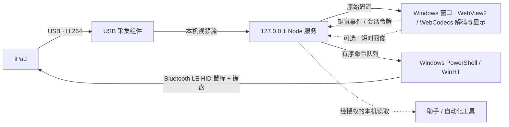

<h1 align="center">iPad Control Console</h1>
<p align="center"><strong>把闲置 iPad，变成电脑旁可以直接操作的一块屏幕。</strong></p>
<p align="center">实时投屏 · 键盘与鼠标 · 本机画面接口</p>
<p align="center"><strong><a href="https://github.com/LiuJH12138/ipad-bluetooth-mouse/releases/download/v1.5.3/iPad-Control-Console-1.5.3-win-x64.msi">下载 Windows x64 应用（1.5.3）</a></strong></p>
<p align="center"><a href="#快速开始">快速开始</a> · <a href="#ai-如何操作-ipad">AI 操作指南</a> · <a href="#如何操作">手动键鼠</a> · <a href="#边界与常见问题">常见问题</a></p>


**1.5.3 更新了本机助手控制。** 开启「允许助手控制」后，`assistant.js` 可以点击当前指针位置，也可以按回传 JPEG 的像素坐标点击输入框，再打字、读图核对。分享窗口短暂停止传图时，输入会暂停；同一窗口恢复传图后可沿用原授权。使用 Computer Use 直接点投屏时，这个开关可以保持关闭。[操作指南](#ai-如何操作-ipad) · [真机实测记录](https://github.com/LiuJH12138/ipad-bluetooth-mouse/blob/v1.5.3/docs/validation.md)

## 这个项目做什么

用一根 USB 数据线把 iPad 画面送到 Windows 桌面控制台，再用电脑的键盘和鼠标操作 iPad。视频走 USB，键鼠走标准蓝牙 HID，两条通道在同一窗口汇合。

| 能力 | 使用方式 |
| --- | --- |
| 实时画面 | USB 直接接收 iPad 的 H.264 视频，桌面窗口通过 WebCodecs 就地解码 |
| 直接键鼠控制 | 点击「开始键鼠控制」，移动、点击、拖动、滚动、输入；`Esc` 退出 |
| 画面点按 | 一键核对三个落点，按投屏坐标直接操作 |
| Windows 键位习惯 | 可将 `Ctrl` 映射到 iPad 的 `Command` |
| 助手视野 | 可选开启本机帧接口，读取短时有效的 JPEG 图像 |
| 独立脚本 | 保留 PowerShell 命令行控制方式 |

**iPad 端免装 App。** Windows 安装包内置 USB 视频组件。当前直连模式只传画面，已有投屏窗口也可通过「共享已有窗口」接入。

## 快速开始

### Windows 应用

1. 从页面顶部下载独立窗口版 MSI。若正在使用旧版，先在托盘菜单选择 **退出应用**，再双击 MSI。在中文向导中选择安装目录，点击 **安装** 即可查看进度。完成页默认勾选 **启动 iPad 控制台**，点击 **完成** 会立即打开应用。以后也可从开始菜单打开。应用内置 Node.js 和 USB 采集组件，由自己的 Windows 窗口承载 WebView2。Windows 11 通常自带 Evergreen Runtime；若提示缺少组件，请安装微软提供的 x64 运行时。[WebView2 Runtime 下载](https://developer.microsoft.com/microsoft-edge/webview2/)
2. 用 USB 数据线接入并解锁 iPad，点 **USB 直连**。新电脑需要先配置 Apple Mobile Device USB 驱动和下文所述的设备过滤驱动。
3. 点 **连接蓝牙** 并完成首次配对。在 iPad 上打开「设置 → 通用」等静止页面，点 **验证坐标**。显示 **绝对坐标直达** 后，就可以用 Windows 箭头点投屏。若想捕获实体鼠标和键盘，点 **开始键鼠控制**。从源码版切换时，先在旧工作台停止投屏并断开蓝牙，让桌面应用接管设备。
4. 关闭窗口后可以从任务栏通知区域重新打开。右键托盘图标选择 **退出应用** 即可关闭本机服务。在 Windows「设置 → 应用 → 已安装的应用」中可以卸载。

### 从源码运行

- Windows 11，蓝牙适配器支持 **BLE 外设角色**。
- Windows 自带的 **PowerShell 5.1**。
- **Node.js 22 或更新版本**；本机验证使用 Node.js 26。
- Microsoft WebView2 Evergreen Runtime。首次从源码启动时会下载并校验固定版本的 WebView2 SDK，编译结果缓存在 build 目录。
- iPad 已解锁，蓝牙开启，能连接标准蓝牙鼠标和键盘。
- 一根支持数据传输的 USB 线。首次连接时，在 iPad 上确认信任电脑。

### USB 配置

从源码运行时，在项目目录执行一次下列命令。脚本校验 Mirrorlab 固定版本的源码和运行库，下载便携 LLVM-MinGW 编译器（约 191 MB，缓存在项目的 `build/tooling`），然后把带静态画面修复的采集组件安装到 `.local/usb-v0.2.0`。MSI 已内置该组件。

```powershell
powershell.exe -NoProfile -File .\Install-UsbReceiver.ps1
```

电脑需要 Apple Mobile Device USB 驱动，以及针对这台 iPad 的 libusb-win32 采集过滤驱动。已有驱动的电脑可以直接启动。新电脑若提示缺少过滤驱动，请按上游的 Windows USB 配置说明为目标设备配置，再重新插线。[Mirrorlab 固定版本](https://github.com/SimonDaBoss/mirrorlab/tree/ade4e6429690ebcf430ea19a142a2e01546da8ef) · [iPhoneMirror 驱动配置](https://github.com/RayrenSX/iPhoneMirror)

### 启动

1. 将整个仓库下载到本地，解压。
2. 双击 **`Start-IpadConsole.cmd`**。启动器在后台启动本机服务，并打开独立桌面窗口。只有显式运行 `Start-IpadConsole.ps1 -Browser` 时才打开浏览器。
3. 用数据线接入并解锁 iPad，关闭其他正在使用它的 USB 投屏窗口，点击 **「USB 直连」**。画面出现后，页面会显示帧率与本机解码绘制耗时。
4. 点击 **「连接蓝牙」**。首次使用时，在 iPad「设置 → 蓝牙」中选择这台 Windows 电脑的名称，并核对两端配对提示。
5. 看到鼠标和键盘均已连接后，按下方指南选择操作方式。手动使用时，可选 **画面操控** 或 **开始键鼠控制**，按 **Esc** 退出。

也可以从项目目录直接打开 USB 预览。

```powershell
powershell.exe -NoProfile -File .\Start-IpadConsole.ps1 -Usb
```

蓝牙配对通常可以复用。使用备用的窗口共享模式时，浏览器会要求手动选择窗口。

## AI 如何操作 iPad

先打开控制台，确认能看见 USB 实时画面，并且蓝牙鼠标和键盘均已连接。

| AI 能使用什么 | 由谁操作、在哪里操作 | 「允许助手控制」 |
| --- | --- | --- |
| 能用 Computer Use 操作 Windows 窗口 | AI 直接看投屏、点目标、在当前焦点打字 | 保持关闭 |
| 能在这台 Windows 电脑上执行命令 | AI 运行随附的 `assistant.js` 读取画面、发送键鼠操作 | 用前打开，用完关闭 |

**有 Computer Use。** 在 iPad 打开清晰、静止的页面，点控制台的 **验证坐标**。确认工具栏显示 **画面操控**，就可以让 AI 直接点击投屏里的输入框，然后输入文字或按退格。普通窗口和全屏用法相同。比如让 AI「点搜索框，输入 58，再退格」，最后从 iPad 回传画面核对是否只剩 `5`。

**没有 Computer Use。** 如果正在捕获键鼠，先按 **Esc** 释放。保持投屏，在工具栏点 **允许助手控制**，然后让能执行本机命令的 AI 从安装目录运行 `assistant.js`。先读一帧，操作后再读一帧核对结果，用完点 **停止助手控制**。仅能网页聊天的 AI 还需要能在这台电脑上执行命令的工具。[PowerShell 示例](#本机助手控制)

## 在投屏画面上使用键鼠

USB 和蓝牙就绪后，选择 **画面操控**。在窗口或全屏中，把 Windows 箭头放到目标上即可操作。点选投屏中的 iPad 输入框后，可直接用电脑键盘输入，支持退格和修饰键。点击控制台上的其他控件会把键盘焦点还给电脑。按 **Esc** 或点 **退出画面操控** 结束。

使用 Computer Use 时，直接点投屏里的 iPad 输入框，再使用键盘输入、退格或粘贴文本。文字显示在 iPad 的光标处。蓝牙键盘按美式键位发送英文、数字和半角标点；中文可切换 iPad 输入法后输入拼音并选字。

| 电脑鼠标操作 | iPad 收到的操作 |
| --- | --- |
| 单击或连续点击两下 | 在目标位置点按，双击效果取决于 App |
| 按住左键 | 保持按下，可打开支持长按的项目菜单 |
| 按住并移动，再松开 | 拖动、划动或选择文字，具体行为由 App 决定 |
| 在列表上滚动滚轮 | 向指针所在区域发送滚轮输入。本次真机复测中，设置列表未响应滚动 |
| 右键、中键 | 发送对应鼠标按钮，由 iPadOS 或辅助触控中的按钮设置决定用途 |

### 验证绝对坐标

1. 连接 USB 投屏和蓝牙，在 iPad 上打开背景简单、指针清楚的页面，例如「设置 → 通用」或空白笔记。
2. 在控制台的「画面定位」区域点 **验证坐标**，暂时停下鼠标。控制台会在三个分散区域里挑选纹理较少的位置，只移动指针并从 USB 画面检查落点。
3. 显示 **绝对坐标直达** 后，即可返回要操作的 App。窗口和全屏共用验证结果。出现 **视觉定位** 时，可换到更清晰的页面重新验证。

显示的最大偏差以最长边缩放至 840 像素的采样图计算。重开窗口、重新连接或旋转 iPad 后需重新验证。

如需返回主屏幕、打开 App 切换器或进行捏合，可点 iPad 的辅助触控悬浮按钮，选择系统提供的操作。辅助触控的“自定义”菜单提供捏合与旋转。[Apple 辅助触控指南](https://support.apple.com/zh-cn/111794)

## 如何操作

画面接入后，点预览下方的 **「全屏」** 即可放大 USB 或窗口共享画面。在全屏中点 **「开始键鼠控制」**，工具栏会自动收起。按 **Esc** 释放键鼠，若仍处于全屏，可点 **「退出全屏」** 返回工作台。

- **移动与点击**：开启控制后，电脑鼠标发送相对位移，左键、拖动和滚轮转发到 iPad。看 iPad 自己的指针定位，可以用页面的速度滑块调整。
- **键盘输入**：开启控制后转发物理键位。支持字母、数字、标点、方向键、Tab、Enter、Backspace 和修饰键。采用标准六键同时按下报告。
- **中文输入**：电脑先切到英文输入法，中文转换由 iPad 上的输入法完成。本项目不复制电脑输入法的候选词或剪贴板。
- **快捷键**：默认将电脑 `Ctrl` 映射成 iPad `Command`，可取消勾选。「打开 iPad 搜索」发送 `Command + Space`。
- **退出与恢复**：`Esc`、切走窗口、页面隐藏或停止共享会释放控制。服务在控制心跳中断超过约 1.2 秒后丢弃待发输入并尝试释放按键。

`Esc` 用于退出键鼠控制。Win、Alt+Tab、Ctrl+Alt+Del 等系统快捷键可能由 Windows 或浏览器处理。键鼠捕获使用电脑鼠标的相对位移。USB 坐标验证通过后，控制台将位移换算为 iPad 的绝对坐标，并用同一蓝牙报告发送左键按下与松开。需要用 Windows 箭头直接点画面时，可切换到「画面操控」。多点触摸和 Apple Pencil 输入暂未支持。

## 工作原理



采集组件通过 USB 接收 iPad 编码好的视频。本机服务原样转发，窗口中的 WebView2 在低延迟模式下解码并绘制。这样省去了桌面窗口捕获和二次编码。键鼠独立通过蓝牙返回 iPad。

## 本机助手控制

在实时预览或全屏工具栏点 **允许助手控制**。此时本机助手可以读取画面、移动 iPad 指针、点击、滚动和发送键盘输入。授权绑定到当前分享窗口。超过 4 秒未收到画面时，服务暂停读图和输入；同一窗口恢复传图后可以继续。点 **停止助手控制**、关闭窗口或停止投屏会结束授权。使用助手前请先释放手动键鼠。

下面的例子让 iPad 打开系统搜索，输入 `7319`，然后保存一帧供助手核对。在安装目录打开 PowerShell；源码版在项目目录运行，并将第一行改为 `$node = 'node'`。

```powershell
$node = '.\runtime\node.exe'
& $node assistant.js status
& $node assistant.js frame "$env:TEMP\ipad-frame.jpg"
& $node assistant.js search
& $node assistant.js frame "$env:TEMP\ipad-search.jpg"
# Inspect the image and confirm the search field is ready before typing.
& $node assistant.js type 7319
& $node assistant.js frame "$env:TEMP\ipad-result.jpg"
```

让助手打开生成的 JPEG 核对输入框和文字。画面最多每秒更新两次，如果仍是操作前的画面，可再取一帧。使用 USB 投屏和支持绝对坐标的 iPad 时，在原始 JPEG 中找到输入框，运行 `click X Y`（左上角为 `0 0`，单位为像素）。读取下一帧确认输入框获得焦点后，再运行 `type 7319`。如控制台尚未验证坐标，脚本会在点按前自动检查三个落点。

`move 40 -20` 从当前指针向右、向上相对移动，`click` 点击当前位置。USB 绝对指针使用画面核对当前位置；若无法辨认，脚本会提示使用坐标。`scroll 3` 发送滚轮输入，`type` 每次接受 1 至 120 个英文字母、数字或空格，退格用 `key Backspace`。这些子命令都跟在 `assistant.js` 后面。

## 助手如何读取画面

在预览工具栏启用 **允许助手控制** 后，本机助手可读取当前画面。

- 最多每秒更新两帧，最长边按宽度上限 1600 像素缩放。
- 服务仅在内存保留最近一帧，4 秒后失效；停止助手控制或投屏后停止发送。
- `GET /api/frame` 返回 JPEG，响应头 `X-Frame-Age-Ms` 表示帧进入本机服务后的年龄。
- 接口使用启动时生成的令牌；运行信息位于已被 Git 忽略的 `.local/session.json`。不要上传或分享该文件。
- 没有可用帧时返回 HTTP 404，不会冒充实时画面。

帧年龄不是 iPad 视频端到端延迟。若投屏软件自身冻结，服务无法仅凭收到的图像证明 iPad 仍在刷新。自动化应结合操作前后的图像变化验证结果。

本项目不把画面上传云端，也不记录按键内容。如果交给助手读取，读取后的处理仍取决于助手服务。

## 本机接口

控制台请求使用 `X-Control-Token`，随附的 `assistant.js` 自动为授权范围内的请求提供 `X-Assistant-Token`。服务只绑定 `127.0.0.1`，校验 Host 和 Origin，供同机工具访问。

| 接口 | 用途 |
| --- | --- |
| `GET /api/status` | 鼠标、键盘、控制租约与图像状态 |
| `POST /api/usb/video` | 打开单个 USB 视频流，关闭连接即释放设备 |
| `POST /api/connect`、`/api/disconnect` | 启停蓝牙子进程 |
| `POST /api/control/start` | 取得唯一控制租约 |
| `POST /api/heartbeat`、`/api/control/stop` | 保活或释放租约 |
| `POST /api/input` | 有序鼠标 / 键盘报告 |
| `GET /api/frame` | 读取已获许可且未过期的画面 |

输入必须携带当前租约和递增序号。队列会合并相邻鼠标移动，保留按键边沿；积压超过上限会停止控制。服务不接受任意 Shell 命令。

## 命令行方式

```powershell
powershell.exe -NoProfile -File .\IpadBluetoothMouse.ps1
```

| 命令 | 示例 |
| --- | --- |
| 查看连接 | `status` |
| 相对移动 | `move 40 -20` |
| 左键点击 | `click` |
| 滚动 | `scroll -3` |
| 完整鼠标报告 | `report 1 10 0 0`：左键按住并右移；`report 0 0 0 0`：释放 |
| 键盘报告 | `keys 2 4`：Shift+A；`keys 0`：释放全部键 |
| 退出 | `quit` |

移动与滚轮范围为 -127～127。键盘修饰键使用位掩码，普通键为 USB HID usage 4～101，最多 6 个。命令行与网页蓝牙服务不能同时运行，脚本有单实例保护。

## 边界与常见问题

| 现象 | 处理 |
| --- | --- |
| USB 直连找不到设备 | 使用数据线，只接入一台已解锁且信任本机的 iPad，并检查 Apple USB 驱动 |
| USB 被占用或没有画面 | 停止其他标签页或软件中的 USB 投屏，等待释放后重试。必要时重新插线 |
| 备用窗口共享没有画面 | 还原实际显示 iPad 画面的窗口，再从「共享已有窗口」中选择它 |
| 鼠标连上，键盘没有连上 | 旧配对可能缓存了鼠标描述符。在 iPad 忽略旧电脑设备，再重新配对组合设备 |
| 蓝牙启动显示 `Aborted` | 确认电脑蓝牙开启、没有其他脚本实例；稍后重试 |
| 启动较慢 | 首次 WinRT / 蓝牙初始化可能需要等待，页面会显示启动状态 |
| 不能进入鼠标捕获 | 点击主控制按钮并允许窗口中的权限提示；检查是否已有其他页面正在控制 |
| 输入位置不对或没有文字 | 先在 iPad 点中可编辑区域，确认「键盘已连接」，电脑切到英文输入法 |
| 键盘快捷键回到了 Windows | 属于系统保留组合键；本项目不安装全局键盘钩子 |
| 找不到 `node.exe` | 安装官方 Node.js 后重开启动器 |

## 验证与开发

在 Windows x64 上使用 PowerShell 7 运行 `./packaging/Build-Windows.ps1` 可生成 MSI 和 SHA-256 文件，输出位于 `build/`。构建使用 Git、已登录的 GitHub CLI、签名的 x64 Node.js 及其随附 LICENSE、Windows .NET Framework 编译器和 WiX 3.14.1。脚本会下载固定版本的 WebView2 SDK、WiX、USB 运行库、对应源码和许可。安装包中的 `licenses/` 包含 WebView2 SDK、Node.js 的许可及 USB 组件的上游资料。

```powershell
node --test
./packaging/Test-DesktopWindow.ps1
node --check server.js
node --check lib/bluetooth.js
node --check web/app.js
```

自动测试覆盖 USB 视频分包、帧大小限制、H.264 关键帧识别、访问隔离、控制租约、输入队列、键鼠释放与图像过期。蓝牙传输使用模拟对象。

实机进展见 [验证记录](docs/validation.md)。

```text
IpadBluetoothMouse.ps1   蓝牙 HID 鼠标与键盘
server.js               仅本机 HTTP 服务与控制租约
lib/bluetooth.js        子进程、协议解析与有序输入队列
lib/usb-video.js        USB 设备检测、采集和视频转发
Install-UsbReceiver.ps1 下载并校验 Windows USB 采集组件
web/                    控制页面与物理键位映射
Start-IpadConsole.cmd   双击入口
Start-IpadConsole.ps1   启动独立窗口，可选浏览器模式
tests/                  不依赖第三方包的自动测试
.local/                 本地运行信息，禁止提交
```

## 参考

- [Apple：在 iPad 上使用蓝牙鼠标或触控板](https://support.apple.com/zh-cn/108938)
- [Apple：iPad 外接键盘快捷键](https://support.apple.com/en-asia/102393)
- [Chrome：屏幕共享控制](https://developer.chrome.com/docs/web-platform/screen-sharing-controls)
- [Microsoft：Bluetooth LE 虚拟键盘示例](https://github.com/microsoft/BluetoothLEExplorer/blob/master/BluetoothLEExplorer/BluetoothLEExplorer/Models/VirtualKeyboard.cs)
- [USB HID Usage Tables](https://www.usb.org/hid)
