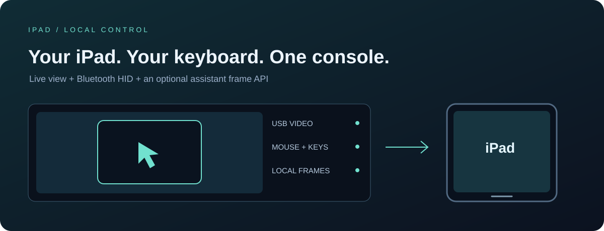
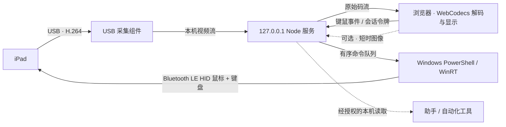

<h1 align="center">iPad Control Console</h1>
<p align="center"><strong>把闲置 iPad，变成电脑旁可以直接操作的一块屏幕。</strong></p>
<p align="center">实时投屏 · 键盘与鼠标 · 本机画面接口</p>
<p align="center"><a href="#快速开始">快速开始</a> · <a href="#如何操作">如何操作</a> · <a href="#助手如何读取画面">助手读取画面</a> · <a href="#边界与常见问题">常见问题</a></p>



## 这个项目做什么

用一根 USB 数据线把 iPad 画面送到 Windows 浏览器，再用电脑的键盘和鼠标操作 iPad。视频走 USB，键鼠走标准蓝牙 HID，两条通道在同一页面汇合。

| 能力 | 使用方式 |
| --- | --- |
| 实时画面 | USB 直接接收 iPad 的 H.264 视频，Chrome 或 Edge 就地解码 |
| 直接键鼠控制 | 点击「开始键鼠控制」，移动、点击、拖动、滚动、输入；`Esc` 退出 |
| 精细调整 | 备用触控板、左键与滚动按钮 |
| Windows 键位习惯 | 可将 `Ctrl` 映射到 iPad 的 `Command` |
| 助手视野 | 可选开启本机帧接口，读取短时有效的 JPEG 图像 |
| 独立脚本 | 保留 PowerShell 命令行控制方式 |

**iPad 端免装 App。** Windows 首次配置需要下载 USB 视频组件。当前直连模式只传画面。已有投屏窗口也可通过「共享已有窗口」接入。

## 快速开始

### 准备

- Windows 11，蓝牙适配器支持 **BLE 外设角色**。
- Windows 自带的 **PowerShell 5.1**。
- **Node.js 22 或更新版本**；本机验证使用 Node.js 26。
- Chrome 或 Edge 桌面浏览器。
- iPad 已解锁，蓝牙开启，能连接标准蓝牙鼠标和键盘。
- 一根支持数据传输的 USB 线。首次连接时，在 iPad 上确认信任电脑。

### USB 配置

在项目目录运行一次下列命令。脚本从 Mirrorlab 的固定提交下载 Windows x64 采集程序和运行库，逐个验证文件后放入 `.local/usb-v0.2.0`。脚本只安装项目目录中的组件，驱动单独配置。

```powershell
powershell.exe -NoProfile -File .\Install-UsbReceiver.ps1
```

电脑需要 Apple Mobile Device USB 驱动，以及针对这台 iPad 的 libusb-win32 采集过滤驱动。已有驱动的电脑可以直接启动。新电脑若提示缺少过滤驱动，请按上游的 Windows USB 配置说明为目标设备配置，再重新插线。[Mirrorlab 固定版本](https://github.com/SimonDaBoss/mirrorlab/tree/ade4e6429690ebcf430ea19a142a2e01546da8ef) · [iPhoneMirror 驱动配置](https://github.com/RayrenSX/iPhoneMirror)

### 启动

1. 将整个仓库下载到本地，解压。
2. 双击 **`Start-IpadConsole.cmd`**。启动器在后台启动本机服务，并打开控制页面。
3. 用数据线接入并解锁 iPad，关闭其他正在使用它的 USB 投屏窗口，点击 **「USB 直连」**。画面出现后，页面会显示帧率与本机解码绘制耗时。
4. 点击 **「连接蓝牙」**。首次使用时，在 iPad「设置 → 蓝牙」中选择这台 Windows 电脑的名称，并核对两端配对提示。
5. 页面显示鼠标、键盘均已连接后，点击 **「开始键鼠控制」**。如浏览器请求鼠标捕获，按提示允许。
6. 按 **`Esc`** 把键鼠还给电脑。

也可以从项目目录直接打开 USB 预览。

```powershell
powershell.exe -NoProfile -File .\Start-IpadConsole.ps1 -Usb
```

蓝牙配对通常可以复用。使用备用的窗口共享模式时，浏览器会要求手动选择窗口。

## 如何操作

画面接入后，点预览下方的 **「全屏」** 即可放大 USB 或窗口共享画面。在全屏中点 **「开始键鼠控制」**，工具栏会自动收起。按 **Esc** 释放键鼠，若仍处于全屏，可点 **「退出全屏」** 返回工作台。

- **移动与点击**：开启控制后，电脑鼠标发送相对位移，左键、拖动和滚轮转发到 iPad。看 iPad 自己的指针定位，可以用页面的速度滑块调整。
- **键盘输入**：开启控制后转发物理键位。支持字母、数字、标点、方向键、Tab、Enter、Backspace 和修饰键。采用标准六键同时按下报告。
- **中文输入**：电脑先切到英文输入法，中文转换由 iPad 上的输入法完成。本项目不复制电脑输入法的候选词或剪贴板。
- **快捷键**：默认将电脑 `Ctrl` 映射成 iPad `Command`，可取消勾选。「打开 iPad 搜索」发送 `Command + Space`。
- **退出与恢复**：`Esc`、切走窗口、页面隐藏或停止共享会释放控制。服务在控制心跳中断超过约 1.2 秒后丢弃待发输入并尝试释放按键。
- **备用触控板**：拖动移动，轻点点击；无需捕获电脑鼠标。

`Esc` 保留给退出控制。Windows 与浏览器保留的系统快捷键（例如 Win、Alt+Tab、Ctrl+Alt+Del）不能保证转发。鼠标是相对控制，尚不支持按图像坐标直接定位，也不模拟多点触摸或 Apple Pencil。

## 工作原理



采集组件通过 USB 接收 iPad 编码好的视频。本机服务原样转发，浏览器在低延迟模式下解码并绘制。这样省去了桌面窗口捕获和二次编码。键鼠独立通过蓝牙返回 iPad。

## 助手如何读取画面

默认关闭。在页面勾选 **「允许本机自动化读取当前画面」** 后：

- 最多每秒更新两帧，最长边按宽度上限 1600 像素缩放。
- 服务仅在内存保留最近一帧，4 秒后失效；关闭开关或停止共享后清空。
- `GET /api/frame` 返回 JPEG，响应头 `X-Frame-Age-Ms` 表示帧进入本机服务后的年龄。
- 接口使用启动时生成的令牌；运行信息位于已被 Git 忽略的 `.local/session.json`。不要上传或分享该文件。
- 没有可用帧时返回 HTTP 404，不会冒充实时画面。

帧年龄不是 iPad 视频端到端延迟。若投屏软件自身冻结，服务无法仅凭收到的图像证明 iPad 仍在刷新。自动化应结合操作前后的图像变化验证结果。

本项目不把画面上传云端，也不记录按键内容。如果交给助手读取，读取后的处理仍取决于助手服务。浏览器「保存当前画面 PNG」和主动调用接口保存文件属于用户明确发起的本地保存。

## 本机接口

所有 `/api/*` 请求都要求 `X-Control-Token`，服务只绑定 `127.0.0.1`，校验 Host 和 Origin，不开放 CORS。接口用于同机工具，不是互联网远控服务。

| 接口 | 用途 |
| --- | --- |
| `GET /api/status` | 鼠标、键盘、控制租约与图像状态 |
| `POST /api/usb/video` | 打开单个 USB 视频流，关闭连接即释放设备 |
| `POST /api/connect`、`/api/disconnect` | 启停蓝牙子进程 |
| `POST /api/control/start` | 取得唯一控制租约 |
| `POST /api/heartbeat`、`/api/control/stop` | 保活或释放租约 |
| `POST /api/input` | 有序鼠标 / 键盘报告 |
| `GET /api/frame` | 读取已获许可且未过期的画面 |

输入必须携带当前租约和递增序号。队列会合并相邻鼠标移动，保留按键边沿；积压超过上限会停止控制。服务不接受任意 Shell 命令。

## 命令行方式

```powershell
powershell.exe -NoProfile -File .\IpadBluetoothMouse.ps1
```

| 命令 | 示例 |
| --- | --- |
| 查看连接 | `status` |
| 相对移动 | `move 40 -20` |
| 左键点击 | `click` |
| 滚动 | `scroll -3` |
| 完整鼠标报告 | `report 1 10 0 0`：左键按住并右移；`report 0 0 0 0`：释放 |
| 键盘报告 | `keys 2 4`：Shift+A；`keys 0`：释放全部键 |
| 退出 | `quit` |

移动与滚轮范围为 -127～127。键盘修饰键使用位掩码，普通键为 USB HID usage 4～101，最多 6 个。命令行与网页蓝牙服务不能同时运行，脚本有单实例保护。

## 边界与常见问题

| 现象 | 处理 |
| --- | --- |
| USB 直连找不到设备 | 使用数据线，只接入一台已解锁且信任本机的 iPad，并检查 Apple USB 驱动 |
| USB 被占用或没有画面 | 停止其他标签页或软件中的 USB 投屏，等待释放后重试。必要时重新插线 |
| 备用窗口共享没有画面 | 还原实际显示 iPad 画面的窗口，再从「共享已有窗口」中选择它 |
| 鼠标连上，键盘没有连上 | 旧配对可能缓存了鼠标描述符。在 iPad 忽略旧电脑设备，再重新配对组合设备 |
| 蓝牙启动显示 `Aborted` | 确认电脑蓝牙开启、没有其他脚本实例；稍后重试 |
| 启动较慢 | 首次 WinRT / 蓝牙初始化可能需要等待，页面会显示启动状态 |
| 不能进入鼠标捕获 | 点击主控制按钮并允许浏览器提示；检查是否已有其他页面正在控制 |
| 输入位置不对或没有文字 | 先在 iPad 点中可编辑区域，确认「键盘已连接」，电脑切到英文输入法 |
| 键盘快捷键回到了 Windows | 属于系统保留组合键；本项目不安装全局键盘钩子 |
| 找不到 `node.exe` | 安装官方 Node.js 后重开启动器 |

## 验证与开发

```powershell
node --test
node --check server.js
node --check lib/bluetooth.js
node --check web/app.js
```

自动测试覆盖 USB 视频分包、帧大小限制、H.264 关键帧识别、访问隔离、控制租约、输入队列、键鼠释放与图像过期。蓝牙传输使用模拟对象。

实机进展见 [验证记录](docs/validation.md)。

```text
IpadBluetoothMouse.ps1   蓝牙 HID 鼠标与键盘
server.js               仅本机 HTTP 服务与控制租约
lib/bluetooth.js        子进程、协议解析与有序输入队列
lib/usb-video.js        USB 设备检测、采集和视频转发
Install-UsbReceiver.ps1 下载并校验 Windows USB 采集组件
web/                    控制页面与物理键位映射
Start-IpadConsole.cmd   双击入口
Start-IpadConsole.ps1   启动并打开浏览器
tests/                  不依赖第三方包的自动测试
.local/                 本地运行信息，禁止提交
```

## 参考

- [Apple：在 iPad 上使用蓝牙鼠标或触控板](https://support.apple.com/zh-cn/108938)
- [Apple：iPad 外接键盘快捷键](https://support.apple.com/en-asia/102393)
- [Chrome：屏幕共享控制](https://developer.chrome.com/docs/web-platform/screen-sharing-controls)
- [Microsoft：Bluetooth LE 虚拟键盘示例](https://github.com/microsoft/BluetoothLEExplorer/blob/master/BluetoothLEExplorer/BluetoothLEExplorer/Models/VirtualKeyboard.cs)
- [USB HID Usage Tables](https://www.usb.org/hid)
