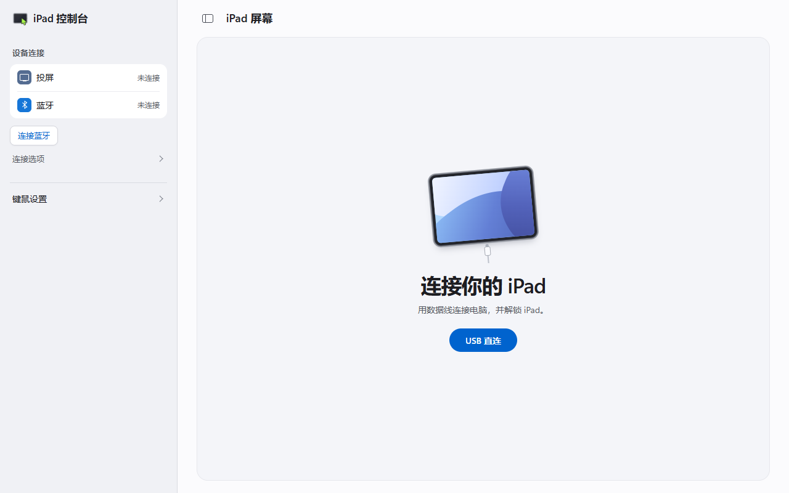

# iPad 控制台 · iPad Control Console

在 Windows 上看 iPad 的实时画面，用电脑的鼠标点按、拖动，用键盘在 iPad 上打字。画面通过 USB 传到电脑，键鼠通过蓝牙连接 iPad。iPad 端无需安装 App。

**[下载 Windows x64 安装包（1.5.4）](https://github.com/LiuJH12138/ipad-bluetooth-mouse/releases/download/v1.5.4/iPad-Control-Console-1.5.4-win-x64.msi)**　·　[使用手册](docs/guide.md)

## 真机演示

点击下方播放 26 秒实录。点播放器的扬声器图标即可听普通话解说，全程附中文字幕。

https://github.com/user-attachments/assets/5f1bf887-d7e8-4cda-b56b-40dcded73699

这段演示录自 USB 直连的 iPad。电脑鼠标点开 GitHub 搜索框，电脑键盘经蓝牙输入 <code>vscode</code>。iPad 显示对应的搜索建议后，控制台切换到全屏。片中剪去了等待时间，输入片段局部放大。[更多真机验证记录](docs/validation.md)

## 快速开始

准备一台 **Windows 11 x64** 电脑、一根支持数据传输的 USB 线，以及一台已解锁的 iPad。需要键鼠控制时，电脑的蓝牙适配器须支持 **BLE 外设角色**。

1. **安装并打开控制台。** 双击 MSI，按中文向导完成安装。旧版用户可先从托盘菜单选择「退出应用」再升级。
2. **先接画面。** 用数据线连接 iPad，在 iPad 上确认信任电脑，然后点「USB 直连」。出现实时画面后就能点右上角「全屏」。只想看屏幕，到这里即可。首次配置的电脑需要 Apple USB 驱动和设备过滤驱动。[USB 配置说明](docs/guide.md#usb-配置)
3. **再接键鼠。** 点「连接蓝牙」，在 iPad 的蓝牙设置里选择这台电脑并确认配对。要用 Windows 箭头直接点画面，可在 iPad 打开背景简单的静止页面，点控制台的「验证坐标」，看到「绝对坐标直达」后选「画面操控」。

## 选择操作方式

| 你想做什么 | 在控制台怎么做 |
| --- | --- |
| 演示、看屏或全屏预览 | 点「USB 直连」，然后按需收起左侧栏或切换全屏。已有投屏窗口可从「连接选项」共享。 |
| 自己用键鼠操作 iPad | 「画面操控」可以直接点画面里的输入框并打字。「开始键鼠控制」会捕获电脑键鼠，适合连续移动、拖动和输入。按 `Esc` 释放。 |
| 让有 Computer Use 的 AI 操作 | 验证坐标后进入「画面操控」。AI 可以在窗口或全屏中看图、点目标、输入文字。「允许助手控制」可保持关闭。 |
| 让能执行本机命令的 AI 操作 | 保持投屏并退出手动控制，点「允许助手控制」。使用随附的 `assistant.js` 读图、点坐标、打字，再读图核对。用完点「停止助手控制」。[命令示例](docs/guide.md#本机助手控制) |

输入中文时，电脑切到英文输入法，在 iPad 上用拼音选字。USB 直连只传画面。当前版本支持鼠标和键盘输入，多点触摸与 Apple Pencil 尚未支持。滚轮响应取决于 iPad App。[键鼠操作说明](docs/guide.md#在投屏画面上使用键鼠)

## 隐私与授权

日常投屏时，视频在电脑本机解码。开启「允许助手控制」后，本机服务只在内存中保留最近一帧供已授权工具读取，画面超过 4 秒未更新就暂停读图和输入。把画面交给外部 AI 后，后续处理取决于该服务。演示只收录控制台与 iPad 上的 GitHub 公开搜索界面，已遮挡账户图标和状态栏。普通话旁白使用 MeloTTS 在本机合成。[助手接口与授权说明](docs/guide.md#助手如何读取画面)

## 开发与支持

- [源码启动与环境要求](docs/guide.md#从源码运行) · [本机 API](docs/guide.md#本机接口) · [运行测试与构建 MSI](docs/guide.md#验证与开发)
- [USB、蓝牙与输入故障排查](docs/guide.md#边界与常见问题) · [提交问题](https://github.com/LiuJH12138/ipad-bluetooth-mouse/issues)
- [全部版本与 SHA-256 校验文件](https://github.com/LiuJH12138/ipad-bluetooth-mouse/releases)

English quick start

Mirror an iPad on Windows 11 x64 over USB and control it with a Bluetooth mouse and keyboard emulated by the PC. No iPad app is required.

1. Install the Windows MSI, connect an unlocked iPad with a USB data cable, trust the PC, and select **USB 直连** (USB Direct). First-time setup requires the Apple USB driver and the device capture filter.
2. For input, select **连接蓝牙** (Connect Bluetooth) and pair the PC in iPad Settings. The PC must support the Bluetooth LE peripheral role. To click directly on the picture, open a still page, select **验证坐标** (Verify coordinates), then **画面操控** (Control on screen).
3. Use **全屏** for full screen. Press **Esc** to release captured input. A Computer Use agent can work directly in the window. For local scripts, opt in with **允许助手控制** and use the bundled `assistant.js`.

