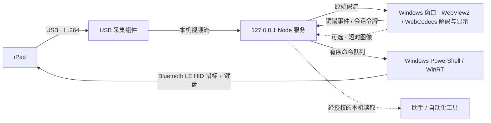

# iPad 控制台使用手册

[返回产品首页](../README.md) · [真机验证记录](validation.md)

## 首次配置

适用于 1.6.0-preview.5 和对应源码。安装版已包含采集程序和 USB 过滤驱动材料。

1. **接线并解锁。** 用支持传输数据的线连接 iPhone 或 iPad，打开控制台，点 **一键配置**。检测到多台设备时，选择这次要配置的设备。
2. **按出现的提示操作。** 缺少 Apple 设备支持时，从界面打开 Microsoft Store 安装 **Apple Devices**，再回到配置页。已有服务和驱动会自动跳过；当 Windows 请求管理员许可时核对并确认。仅当向导提示时才需重新插线。
3. **在设备上确认配对。** 如果设备询问是否信任电脑，请在设备上确认。按向导提示开启辅助触控，在设备的蓝牙设置中选择向导显示的电脑名称并核对配对码。保持一个背景清晰、静止的页面，方便控制台核对 USB 画面与蓝牙指针。核对成功即可点画面、用键盘输入。

只需要画面时选 **仅投屏**。之后若想补配驱动，在 **切换设备** 中选中目标，再点 **配置此设备**。自动配置不会开启助手读图授权。关闭或取消后可以重新进入，控制台会再检查实际状态。旧式相对鼠标的人工核对见下节。[Apple 对「信任此电脑」的说明](https://support.apple.com/zh-cn/109054)

## 在 Windows 上控制 iPhone

iPhone 和 iPad 共用同一套首次配置。iPhone 的辅助触控位于「设置 → 辅助功能 → 触控 → 辅助触控」。

### 同时接着 iPhone 和 iPad

- 两台设备都可以保留 USB 和蓝牙连接，控制台每次显示、控制其中一台。要换机，点画面右上角的 **切换设备**，再选另一台。
- 当前源码在列表、窗口标题、侧栏和全屏里使用相同的八位本机短码与设备名。同名设备可凭短码区分。设备未提供名字时显示型号或类型。投屏后展开 **连接详情**，输入 **本机别名** 并保存，例如“工作 iPad”。别名保存在当前 Windows 用户目录，重启控制台后仍可使用；清空并保存可恢复设备名称。
- 首次核对时，控制台依次向候选蓝牙设备发送指针移动，用当前 USB 画面核实三个落点。若只看得到投屏、核对却反复失败，请在这根 USB 线连接的设备上打开「设置 → 蓝牙」，确认电脑显示“已连接”，再停在「设置 → 通用」重试。
- 旧式蓝牙接收端只支持相对移动时，请只保留目标设备的 USB 线，以及它到电脑的蓝牙连接。可以暂时断开其他设备与电脑的蓝牙连接，保留原有配对。点 **刷新连接**，再点 **移动指针核对**。亲眼看到当前 USB 画面中的指针向右移动后，60 秒内点 **我已看到指针移动**。
- 窗口标题下方会显示当前目标的控制状态；进入全屏并捕获鼠标后，左上角仍可核对设备及状态。显示 **等待画面更新** 时，静止页面可能暂时没有新帧。需要操控时，控制台会尝试移动指针并查看新画面；核对失败时请解锁目标设备、切到清晰页面后再试。
- 切换会释放按住的键和鼠标按钮，并撤销上一台的助手授权。设备与蓝牙持续在线时，控制台可以复用已核对的对应关系。若切换时 Windows 重新识别了 USB 设备，回到它的画面后，控制台会先对刚才核对过的蓝牙接收者重新做三点验证。蓝牙也已重连或无法确认落点时，画面保持仅预览，可手动点 **核对蓝牙设备**。旋转后看左栏的「指针定位」确认是否需要重新验证。
- 有 Computer Use 的助手直接操作控制台窗口。使用脚本的助手需要在当前设备的实时预览中手动打开 **允许助手控制**，然后运行下文的读图、点击和键盘命令。

### 为什么两台设备的蓝牙列表里显示同一台电脑？

iPad 和 iPhone 连接的是同一台 Windows 电脑提供的键鼠配件。向导用电脑名提示你选择配件。当前 Windows 蓝牙接口由系统管理广播名称，控制台无法向不同接收端分别广播“iPad 键鼠”和“iPhone 键鼠”。[微软的 GATT 广播参数](https://learn.microsoft.com/en-us/uwp/api/windows.devices.bluetooth.genericattributeprofile.gattserviceprovideradvertisingparameters?view=winrt-28000) · [微软的广播名称限制](https://learn.microsoft.com/en-us/uwp/api/windows.devices.bluetooth.advertisement.bluetoothleadvertisementpublisher.advertisement?view=winrt-28000)

想在苹果设备上区分显示时，可分别打开「设置 → 蓝牙」，点已连接电脑旁的 ⓘ。如果详情里有「名称」，可以直接填写想显示的名字，然后在两台设备上核对显示结果。这一步可沿用现有配对。已验证键鼠控制时，也可在电脑的投屏画面中点开同一页面操作。控制台没有直接写入这个设置的接口。苹果说明有些配件不能改名或保存新名称，两台设备能否各自保留需要实际确认。[Apple 的蓝牙配件改名说明](https://support.apple.com/zh-cn/101407)

想在 **Windows 控制台** 中区分两台设备，可设置各自的**本机别名**。选择设备时看别名和八位短码。发送键鼠输入前，控制台还会把蓝牙指针和 USB 画面核对，随后向已核对的蓝牙接收端定向发送。

### 只断开一台的蓝牙，再连回来

先退出当前键鼠控制。在要断开的 iPad 上打开「设置 → 蓝牙」，点电脑名称旁的 ⓘ。如果列表里有「断开连接」，选择它即可保留配对。重新连接时，在 iPad 上用触屏点「我的设备」里的同一项，回到投屏窗口，按提示重新核对指针。控制台侧栏的「断开蓝牙」会停止电脑端的键鼠服务，影响连接到它的所有设备。[Apple 的 iPad 蓝牙鼠标连接说明](https://support.apple.com/zh-cn/108938)

## 快速开始

### Windows 应用（已发布的 1.5.4 安装版）

1. 从[产品首页](../README.md)下载独立窗口版 MSI。若正在使用旧版，先在托盘菜单选择 **退出应用**，再双击 MSI。在中文向导中选择安装目录，点击 **安装** 即可查看进度。完成页默认勾选 **启动 iPad 控制台**，点击 **完成** 会立即打开应用。以后也可从开始菜单打开。应用内置 Node.js 和 USB 采集组件，由自己的 Windows 窗口承载 WebView2。Windows 11 通常自带 Evergreen Runtime；若提示缺少组件，请安装微软提供的 x64 运行时。[WebView2 Runtime 下载](https://developer.microsoft.com/microsoft-edge/webview2/)
2. 用 USB 数据线接入并解锁 iPad，点 **USB 直连**。新电脑需要先配置 Apple Mobile Device USB 驱动和下文所述的设备过滤驱动。
3. 点 **连接蓝牙** 并完成首次配对。在 iPad 上打开「设置 → 通用」等静止页面，点 **验证坐标**。显示 **绝对坐标直达** 后，就可以用 Windows 箭头点投屏。若想捕获实体鼠标和键盘，点 **开始键鼠控制**。从源码版切换时，先在旧工作台停止投屏并断开蓝牙，让桌面应用接管设备。
4. 关闭窗口后可以从任务栏通知区域重新打开。右键托盘图标选择 **退出应用** 即可关闭本机服务。在 Windows「设置 → 应用 → 已安装的应用」中可以卸载。

### 从源码运行

- Windows 11，蓝牙适配器支持 **BLE 外设角色**。
- Windows 自带的 **PowerShell 5.1**。
- **Node.js 22 或更新版本**；本机验证使用 Node.js 26。
- Microsoft WebView2 Evergreen Runtime。首次从源码启动时会下载并校验固定版本的 WebView2 SDK，编译结果缓存在 build 目录。
- iPad 已解锁，蓝牙开启，能连接标准蓝牙鼠标和键盘。
- 一根支持数据传输的 USB 线。首次连接时，在 iPad 上确认信任电脑。

### USB 配置

从源码运行时，首页的 **一键配置** 可以准备缺失的采集组件。手动构建或排查下载失败时，在项目目录执行下列命令。脚本校验 Mirrorlab 固定版本的源码和运行库，下载便携 LLVM-MinGW 编译器（约 191 MB，缓存在项目的 `build/tooling`），然后把带静态画面修复的采集组件安装到 `.local/usb-v0.2.0`。MSI 已内置该组件。

```powershell
powershell.exe -NoProfile -File .\Install-UsbReceiver.ps1
```

电脑需要 Apple Mobile Device USB 驱动，以及针对这台 iPad 的 libusb-win32 采集过滤驱动。已有驱动的电脑可以直接启动。新版会按所选设备配置缺失的过滤驱动。手动排查或使用旧安装版时，可参阅上游的 Windows USB 配置说明。[Mirrorlab 固定版本](https://github.com/SimonDaBoss/mirrorlab/tree/ade4e6429690ebcf430ea19a142a2e01546da8ef) · [iPhoneMirror 驱动配置](https://github.com/RayrenSX/iPhoneMirror)

### 启动

1. 将整个仓库下载到本地，解压。
2. 双击 **`Start-IpadConsole.cmd`**。启动器在后台启动本机服务，并打开独立桌面窗口。只有显式运行 `Start-IpadConsole.ps1 -Browser` 时才打开浏览器。
3. 用数据线接入并解锁 iPhone 或 iPad，关闭其他正在使用它的 USB 投屏，点 **一键配置**。只想看画面时选 **仅投屏**。
4. 根据向导完成首次信任和蓝牙配对。看到实时画面后，可在 **连接详情** 查看帧率和键鼠状态，在 **操控方式** 切换输入模式。

也可以从项目目录直接打开 USB 预览。

```powershell
powershell.exe -NoProfile -File .\Start-IpadConsole.ps1 -Usb
```

蓝牙配对通常可以复用。

## AI 如何操作 iPad

先打开控制台，确认能看见 USB 实时画面，并且蓝牙鼠标和键盘均已连接。

| AI 能使用什么 | 由谁操作、在哪里操作 | 「允许助手控制」 |
| --- | --- | --- |
| 能用 Computer Use 操作 Windows 窗口 | AI 直接看投屏、点目标、在当前焦点打字 | 保持关闭 |
| 能在这台 Windows 电脑上执行命令 | AI 运行随附的 `assistant.js` 读取画面、发送键鼠操作 | 用前打开，用完关闭 |

**有 Computer Use。** 在 iPad 打开清晰、静止的页面，点控制台的 **验证坐标**。确认工具栏显示 **画面操控**，就可以让 AI 直接点击投屏里的输入框，然后输入文字或按退格。普通窗口和全屏用法相同。比如让 AI「点搜索框，输入 58，再退格」，最后从 iPad 回传画面核对是否只剩 `5`。

**没有 Computer Use。** 如果正在捕获键鼠，先按 **Esc** 释放。保持投屏，在工具栏点 **允许助手控制**，然后让能执行本机命令的 AI 从安装目录运行 `assistant.js`。先读一帧，操作后再读一帧核对结果，用完点 **停止助手控制**。仅能网页聊天的 AI 还需要能在这台电脑上执行命令的工具。[PowerShell 示例](#本机助手控制)

## 在投屏画面上使用键鼠

USB 和蓝牙就绪后，选择 **画面操控**。在窗口或全屏中，把 Windows 箭头放到目标上即可操作。点选投屏中的 iPad 输入框后，可直接用电脑键盘输入，支持退格和修饰键。点击控制台上的其他控件会把键盘焦点还给电脑。在源码预览版中，按 **Esc** 或从 **操控方式** 选 **仅预览** 结束。1.5.4 安装版也可以点 **退出画面操控**。

使用 Computer Use 时，直接点投屏里的 iPad 输入框，再使用键盘输入、退格或粘贴文本。文字显示在 iPad 的光标处。蓝牙键盘按美式键位发送英文、数字和半角标点；中文可切换 iPad 输入法后输入拼音并选字。

| 电脑鼠标操作 | iPad 收到的操作 |
| --- | --- |
| 单击或连续点击两下 | 在目标位置点按，双击效果取决于 App |
| 按住左键 | 保持按下，可打开支持长按的项目菜单 |
| 按住并移动，再松开 | 拖动、划动或选择文字，具体行为由 App 决定 |
| 在列表上滚动滚轮 | 在 iPhone 上验证绝对坐标，进入「画面操控」，把鼠标放到列表上，转动滚轮即可上下翻动。控制台逐格发送蓝牙滚轮。iPad、键鼠捕获模式和脚本沿用各自原有的滚轮处理，响应取决于设备和 App。 |
| 右键、中键 | 发送对应鼠标按钮，由 iPadOS 或辅助触控中的按钮设置决定用途 |

### 验证绝对坐标

1. 连接 USB 投屏和蓝牙，在 iPad 上打开背景简单、指针清楚的页面，例如「设置 → 通用」或空白笔记。
2. 在控制台的「指针定位」区域点 **验证坐标**，暂时停下鼠标。控制台会在三个分散区域里挑选纹理较少的位置，只移动指针并从 USB 画面检查落点。
3. 显示 **绝对坐标直达** 后，即可返回要操作的 App。窗口和全屏共用验证结果。出现 **视觉定位** 时，可换到更清晰的页面重新验证。

源码预览版会在左栏 **连接详情** 中显示三点验证的最大偏差。数值以最长边缩放至 840 像素的采样图计算。重开窗口、重新连接或旋转 iPad 后需重新验证。

如需返回主屏幕、打开 App 切换器或进行捏合，可点 iPad 的辅助触控悬浮按钮，选择系统提供的操作。辅助触控的“自定义”菜单提供捏合与旋转。[Apple 辅助触控指南](https://support.apple.com/zh-cn/111794)

## 如何操作

源码预览版在画面下方提供 **操控方式** 选择器。选择 **仅预览** 看屏；选择 **画面操控** 后，电脑鼠标可以直接点击投屏中的目标；选择 **键鼠控制** 可捕获电脑鼠标和键盘，按 **Esc** 释放。**允许助手控制** 是独立开关，供使用 `assistant.js` 的本机脚本请求读图和输入。进入全屏后也可使用这些控件。

在左栏展开 **连接详情** 可查看键盘状态、采集指标和定位误差，也可在这里 **停止投屏**。

控制台将设备连接、指针定位和键鼠设置放在左侧栏。点屏幕标题左侧的侧栏按钮即可收起或展开。窄窗口默认收起，展开后设置显示在预览上方。

- **移动与点击**：开启控制后，电脑鼠标发送相对位移，左键、拖动和滚轮转发到 iPad。看 iPad 自己的指针定位，可以用页面的速度滑块调整。
- **键盘输入**：开启控制后转发物理键位。支持字母、数字、标点、方向键、Tab、Enter、Backspace 和修饰键。采用标准六键同时按下报告。
- **中文输入**：电脑先切到英文输入法，中文转换由 iPad 上的输入法完成。本项目不复制电脑输入法的候选词或剪贴板。
- **快捷键**：默认将电脑 `Ctrl` 映射成 iPad `Command`，可在 **键鼠设置** 中取消勾选。
- **退出与恢复**：`Esc`、切走窗口、页面隐藏或停止投屏会释放控制。服务在控制心跳中断超过约 1.2 秒后丢弃待发输入并尝试释放按键。

`Esc` 用于退出键鼠控制。Win、Alt+Tab、Ctrl+Alt+Del 等系统快捷键可能由 Windows 或浏览器处理。键鼠捕获使用电脑鼠标的相对位移。USB 坐标验证通过后，控制台将位移换算为 iPad 的绝对坐标，并用同一蓝牙报告发送左键按下与松开。需要用 Windows 箭头直接点画面时，可切换到「画面操控」。多点触摸和 Apple Pencil 输入暂未支持。

## 工作原理



采集组件通过 USB 接收 iPad 编码好的视频。本机服务原样转发，窗口中的 WebView2 在低延迟模式下解码并绘制。这样省去了桌面窗口捕获和二次编码。键鼠独立通过蓝牙返回 iPad。

## 本机助手控制

在实时预览或全屏工具栏点 **允许助手控制**。此时本机助手可以读取画面、移动 iPad 指针、点击、滚动和发送键盘输入。授权绑定到当前分享窗口。超过 4 秒没有新解码帧时会暂停读图和普通输入。下一次操作会自动移动指针并核对往返与画面内容；若仍冻结、目标已改变或无法确定原位，该次操作会取消。点 **停止助手控制**、关闭窗口或停止投屏会结束授权。使用助手前请先释放手动键鼠。

下面的例子演示点开输入框、输入 `7319` 并读取结果。在安装目录打开 PowerShell；源码版在项目目录运行，并将第一行改为 `$node = 'node'`。先读图，确认输入框的位置，再将示例坐标替换为实际像素坐标。

```powershell
$node = '.\runtime\node.exe'
& $node assistant.js status
& $node assistant.js frame "$env:TEMP\ipad-frame.jpg"
# Replace the example coordinates with the input field's location in the JPEG.
& $node assistant.js click 500 200
& $node assistant.js frame "$env:TEMP\ipad-focus.jpg"
# Check that the field is focused before typing.
& $node assistant.js type 7319
& $node assistant.js frame "$env:TEMP\ipad-result.jpg"
```

让助手打开生成的 JPEG 核对输入框和文字。画面最多每秒更新两次，如果仍是操作前的画面，可再取一帧。使用 USB 投屏和支持绝对坐标的 iPad 时，在原始 JPEG 中找到输入框，运行 `click X Y`（左上角为 `0 0`，单位为像素）。读取下一帧确认输入框获得焦点后，再运行 `type 7319`。如控制台尚未验证坐标，脚本会在点按前自动检查三个落点。

`move 40 -20` 从当前指针向右、向上相对移动，`click` 点击当前位置。USB 绝对指针使用画面核对当前位置；若无法辨认，脚本会提示使用坐标。`scroll 3` 发送滚轮输入，`type` 每次接受 1 至 120 个英文字母、数字或空格，退格用 `key Backspace`。这些子命令都跟在 `assistant.js` 后面。

## 助手如何读取画面

在预览工具栏启用 **允许助手控制** 后，本机助手可读取当前画面。

- 最多每秒更新两帧，最长边按宽度上限 1600 像素缩放。
- 服务仅在内存保留最近一帧，4 秒后失效；停止助手控制或投屏后停止发送。
- `GET /api/frame` 返回 JPEG，响应头 `X-Frame-Age-Ms` 表示该截图对应的 USB 解码帧年龄。
- 接口使用启动时生成的令牌；运行信息位于已被 Git 忽略的 `.local/session.json`。不要上传或分享该文件。
- 没有可用帧时返回 HTTP 404，不会冒充实时画面。

帧年龄不是 iPad 视频端到端延迟。若投屏软件自身冻结，服务无法仅凭收到的图像证明 iPad 仍在刷新。自动化应结合操作前后的图像变化验证结果。

本项目不把画面上传云端，也不记录按键内容。如果交给助手读取，读取后的处理仍取决于助手服务。

## 本机接口

控制台请求使用 `X-Control-Token`，随附的 `assistant.js` 自动为授权范围内的请求提供 `X-Assistant-Token`。服务只绑定 `127.0.0.1`，校验 Host 和 Origin，供同机工具访问。

| 接口 | 用途 |
| --- | --- |
| `GET /api/status` | 鼠标、键盘、当前投屏目标、控制租约、最近解码帧序号及帧龄 |
| `GET /api/devices` | 列出已连接的 USB 设备，返回本机设备标识、名称或型号、本机别名和驱动状态 |
| `POST /api/device/alias` | 在控制台为当前投屏的 deviceId 设置 alias，空字符串恢复设备名称 |
| `POST /api/usb/video` | 打开设备列表中选定的 `deviceId`。响应头 `X-USB-Session` 标识本次投屏，重新打开后会改变。关闭连接即释放设备。 |
| `POST /api/usb/stop` | 传入原投屏的 `sessionId`，等待采集组件释放设备后再切换目标。 |
| `POST /api/connect`、`/api/disconnect` | 启停蓝牙子进程 |
| `POST /api/control/start` | 控制台用当前 `deviceId` 和 `sessionId` 申请唯一的控制租约；助手使用当前窗口授予的凭据申请 |
| `POST /api/heartbeat`、`/api/control/stop` | 保活或释放租约 |
| `POST /api/input` | 有序鼠标 / 键盘报告 |
| `GET /api/frame` | 读取已获许可且未过期的画面 |

输入必须携带当前租约和递增序号。队列会合并相邻鼠标移动，保留按键边沿；积压超过上限会停止控制。服务不接受任意 Shell 命令。

## 命令行方式

```powershell
powershell.exe -NoProfile -File .\IpadBluetoothMouse.ps1
```

| 命令 | 示例 |
| --- | --- |
| 查看连接 | `status` |
| 相对移动 | `move 40 -20` |
| 左键点击 | `click` |
| 滚动 | `scroll -3` |
| 完整鼠标报告 | `report 1 10 0 0`：左键按住并右移；`report 0 0 0 0`：释放 |
| 键盘报告 | `keys 2 4`：Shift+A；`keys 0`：释放全部键 |
| 退出 | `quit` |

移动与滚轮范围为 -127～127。键盘修饰键使用位掩码，普通键为 USB HID usage 4～101，最多 6 个。命令行与网页蓝牙服务不能同时运行，脚本有单实例保护。

## 边界与常见问题

| 现象 | 处理 |
| --- | --- |
| USB 直连找不到设备 | 解锁目标设备，检查数据线、信任状态和这台设备的驱动。在设备选择器中点「刷新」。 |
| USB 被占用或没有画面 | 停止其他标签页或软件中的 USB 投屏，等待释放后重试。必要时重新插线 |
| 鼠标连上，键盘没有连上 | 旧配对可能缓存了鼠标描述符。在 iPad 忽略旧电脑设备，再重新配对组合设备 |
| 蓝牙启动显示 `Aborted` | 确认电脑蓝牙开启、没有其他脚本实例；稍后重试 |
| 启动较慢 | 首次 WinRT / 蓝牙初始化可能需要等待，页面会显示启动状态 |
| 不能进入鼠标捕获 | 点击主控制按钮并允许窗口中的权限提示；检查是否已有其他页面正在控制 |
| 输入位置不对或没有文字 | 先在 iPad 点中可编辑区域，确认「键盘已连接」，电脑切到英文输入法 |
| 键盘快捷键回到了 Windows | 属于系统保留组合键；本项目不安装全局键盘钩子 |
| 找不到 `node.exe` | 安装官方 Node.js 后重开启动器 |

## 验证与开发

在 Windows x64 上使用 PowerShell 7 运行 `./packaging/Build-Windows.ps1` 可生成 MSI 和 SHA-256 文件，输出位于 `build/`。构建使用 Git、已登录的 GitHub CLI、签名的 x64 Node.js 及其随附 LICENSE、Windows .NET Framework 编译器和 WiX 3.14.1。脚本会下载固定版本的 WebView2 SDK、WiX、USB 运行库、对应源码和许可。安装包中的 `licenses/` 包含 WebView2 SDK、Node.js 的许可及 USB 组件的上游资料。

```powershell
node --test 'tests/*.test.js'
./packaging/Test-DesktopWindow.ps1
node --check server.js
node --check lib/bluetooth.js
node --check web/app.js
```

自动测试覆盖 USB 视频分包、帧大小限制、H.264 关键帧识别、访问隔离、控制租约、输入队列、键鼠释放与图像过期。蓝牙传输使用模拟对象。

双设备真机验收可单独运行 `./packaging/Test-DesktopWindow.ps1 -DualDevice`。先在旧窗口停止投屏、断开蓝牙服务，让两台已配对的设备保持解锁并显示静止页面。验收窗口依次打开两个真实 USB 画面，为每台设备进行三点指针核对，再切回第一台检查控制归属。测试只发送未按键的指针移动，并在结束时释放资源。需要指定首先投屏的设备时，在命令末尾加 `-FirstDevice` 和控制台显示的八位短码。

实机进展见 [验证记录](validation.md)。

```text
IpadBluetoothMouse.ps1   蓝牙 HID 鼠标与键盘
server.js               仅本机 HTTP 服务与控制租约
lib/bluetooth.js        子进程、协议解析与有序输入队列
lib/usb-video.js        USB 设备检测、采集和视频转发
Install-UsbReceiver.ps1 下载并校验 Windows USB 采集组件
web/                    控制页面与物理键位映射
Start-IpadConsole.cmd   双击入口
Start-IpadConsole.ps1   启动独立窗口，可选浏览器模式
tests/                  不依赖第三方包的自动测试
.local/                 本地运行信息，禁止提交
```

## 参考

- [Apple：在 iPad 上使用蓝牙鼠标或触控板](https://support.apple.com/zh-cn/108938)
- [Apple：iPad 外接键盘快捷键](https://support.apple.com/en-asia/102393)
- [Microsoft：Bluetooth LE 虚拟键盘示例](https://github.com/microsoft/BluetoothLEExplorer/blob/master/BluetoothLEExplorer/BluetoothLEExplorer/Models/VirtualKeyboard.cs)
- [USB HID Usage Tables](https://www.usb.org/hid)
